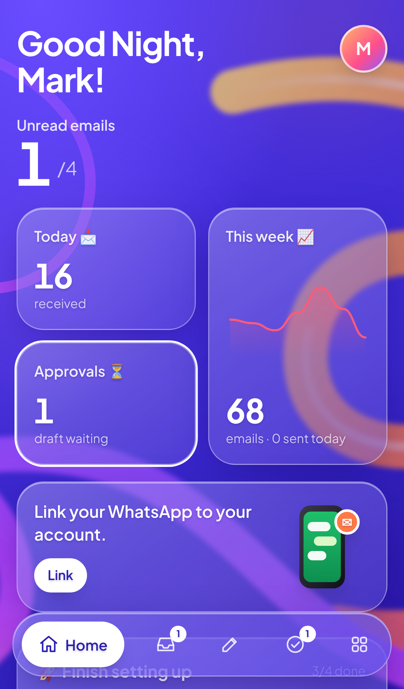
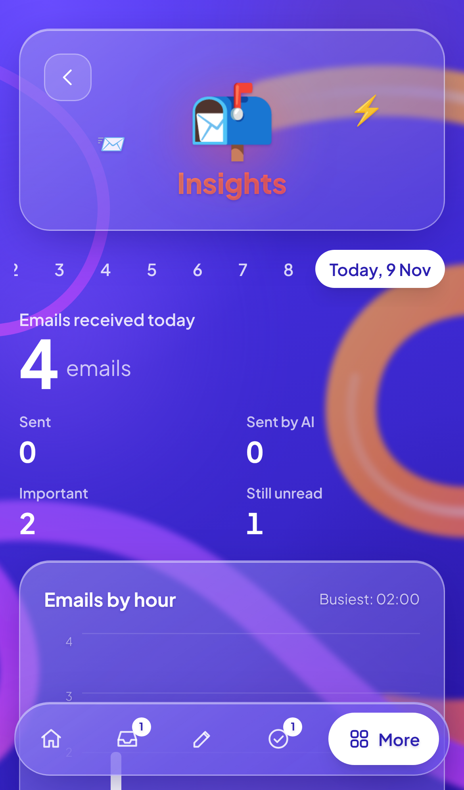
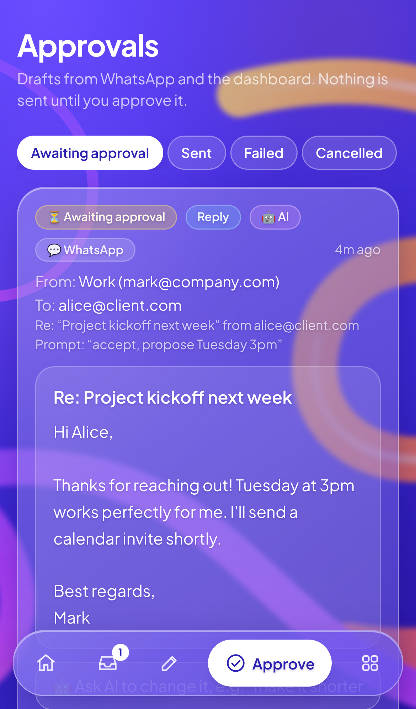
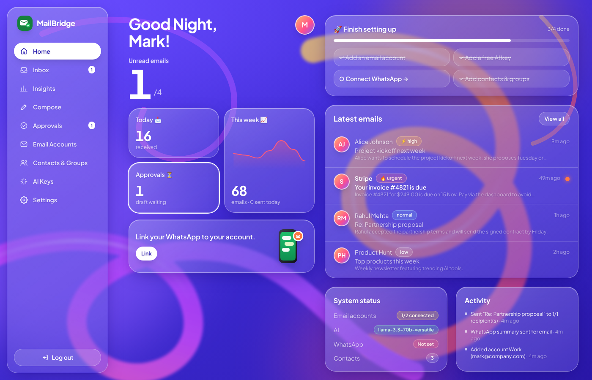

# 📬 MailBridge

**Your inbox, summarized on WhatsApp. AI-written replies are sent only after you approve them.**

MailBridge watches your email accounts in real time. When a new email arrives, the AI summarizes it and sends the summary to your WhatsApp. You can reply from WhatsApp in two ways: write the reply yourself, or tell the AI what to say ("accept, propose Tuesday 3pm"). Either way you get a draft, and **nothing is sent until you tap ✅ Send**. You can also send new emails to one person, a group, or all your contacts, from WhatsApp or from the web dashboard (which you can install on your phone as an app).

| Home | Insights | Approvals |
|---|---|---|
|  |  |  |



The UI uses a **glassmorphism** design: a vivid indigo background with glowing 3D ribbons, frosted-glass cards, big bold numbers, white pill buttons and a floating tab bar on mobile.

---

## ✨ Features

**Email → WhatsApp**
- Real-time inbox watching (IMAP IDLE) for **multiple accounts**: Gmail, Outlook, Zoho, Yahoo, Hostinger, any IMAP/SMTP
- AI **summary, priority** (low/normal/high/urgent) and **category** for every email
- WhatsApp card with **🤖 Reply with AI · ✍️ Reply myself · 🙈 Ignore** buttons
- Notification rules: minimum priority, quiet hours (urgent mail still comes through), per-account on/off

**WhatsApp → Email**
- Swipe-reply to an email card with instructions and the AI writes the reply
- `reply: <text>` sends your exact words
- `new <to> | <subject> | <instructions>` makes the AI write a new email
- `<to>` can be email address(es), a contact name, a **group** name, or **all**
- Every draft comes back with **✅ Send · ✏️ Edit · ❌ Cancel**. Edit lets the AI revise it, or you can replace the text yourself
- Broadcasts go out as **one personal email per recipient**, with `{{name}}` replaced by each contact's name

**Dashboard (web + installable PWA)**
- **Home**: greeting, unread count, today / this-week / approvals tiles with a 7-day trend line
- **Insights**: pick any day to see emails received, sent, sent by AI and important, plus an emails-by-hour chart and top categories
- **Email accounts**: add, edit, delete, enable/disable, set default, test connection, see live status
- **AI Keys**: add, edit, delete, test and switch between AI providers and API keys (Groq, Gemini, OpenRouter, OpenAI, Ollama, any OpenAI-compatible API)
- **Inbox**: all accounts or one, search, unread / important / sent / archived, AI summary, reply, AI reply, archive, delete (optionally on the server too), forward to WhatsApp
- **Compose**: to addresses, a group or everyone; write it yourself or with AI
- **Approvals**: review, edit, AI-revise, approve or reject drafts from WhatsApp and the dashboard
- **Contacts & Groups**: create, edit, delete, CSV import
- **Settings**: WhatsApp credentials, notification rules, AI tone/language/sign-off, password

**Security**
- Mailbox passwords, AI keys and WhatsApp tokens are **AES-256-GCM encrypted** in the database and never sent to the browser
- WhatsApp webhook **signature verification** (`X-Hub-Signature-256`). Only **your** number can give commands
- Login-protected dashboard with login rate limiting. Each draft can only be sent once, so a double tap won't send it twice

---

## 🗄️ Do I need a database?

**Yes, but you don't have to install anything.** MailBridge uses **SQLite**, a single file at `data/mailbridge.db` that is created automatically. It stores your accounts, emails, summaries, drafts, contacts, AI keys and settings. To use PostgreSQL instead, change `provider = "sqlite"` to `"postgresql"` in `prisma/schema.prisma` and set `DATABASE_URL`.

---

## 🚀 Quick start (local)

Requirements: **Node.js 20+**

```bash
git clone https://github.com/autoshifttech/email.git
cd email
npm install
cp .env.example .env
```

Edit `.env` and set two random secrets:

```bash
openssl rand -hex 32   # paste into AUTH_SECRET
openssl rand -hex 32   # paste into ENCRYPTION_KEY
```

Create the database, build, and run the web app and the email worker:

```bash
npx prisma db push
npm run build
npm run start:all
```

Open **http://localhost:3000**, create your owner account, then follow the **"Finish setting up"** checklist on the Overview page.

> For development, use `npm run dev:all` (hot reload).

### Run with Docker

```bash
cp .env.example .env    # set AUTH_SECRET, ENCRYPTION_KEY, APP_URL
docker compose up -d --build
```

---

## 🔧 Setup guides

### 1. Add an email account (Gmail example)
1. Turn on **2-Step Verification** for your Google account.
2. Create an **App Password** at <https://myaccount.google.com/apppasswords>.
3. In MailBridge go to **Email Accounts → + Add account → Gmail**, enter your address and the 16-character app password, click **Test connection**, then **Add account**.

Within a few seconds the status turns **Connected**. Your 20 most recent emails are imported without notifications. New emails from then on are summarized and sent to WhatsApp.

### 2. Add a free AI key
Go to **AI Keys → + Add AI key** and pick a provider:

| Provider | Free? | Get a key |
|---|---|---|
| **Groq** (recommended) | ✅ free tier | <https://console.groq.com/keys> |
| **Google Gemini** | ✅ free tier | <https://aistudio.google.com/apikey> |
| **OpenRouter** (`:free` models) | ✅ | <https://openrouter.ai/keys> |
| **Ollama** (your own machine) | ✅ | <https://ollama.com> |
| OpenAI | paid | <https://platform.openai.com/api-keys> |

Paste the key, click **Test**, then **Save**. You can store several keys and switch the active one with **Use this**, for example when one hits its rate limit.

### 3. Connect WhatsApp (Meta WhatsApp Cloud API)
1. Go to <https://developers.facebook.com> → **My Apps → Create app** → type **Business** → add the **WhatsApp** product.
2. Under **WhatsApp → API Setup**, copy the **Phone number ID**. Add your personal number as a recipient and verify it. For a quick test you can use Meta's free test number.
3. Create a **permanent access token**: Business Settings → **System users** → add a user → **Generate token** with `whatsapp_business_messaging` and `whatsapp_business_management`. (The 24-hour temporary token also works for testing.)
4. Copy the **App secret** from **App settings → Basic**.
5. In MailBridge **Settings → WhatsApp**, fill in your number (with country code, e.g. `919876543210`), the phone number ID, the access token, the app secret, and a **verify token** you make up. Save, then click **Send test message**.
6. **Webhook**: in Meta → WhatsApp → **Configuration**, set the **Callback URL** to the one shown in MailBridge settings (`https://your-domain/api/whatsapp/webhook`) and the same **verify token**. Then **subscribe to `messages`**.
   - Meta needs a public HTTPS URL. On a local machine you can use a free tunnel:
     ```bash
     npx cloudflared tunnel --url http://localhost:3000
     ```
     Then set `APP_URL` in `.env` to the tunnel URL.
7. **Template for the 24-hour rule.** WhatsApp only allows free-form messages within 24 hours of your last message to the bot. To still receive alerts after that, create a message template in **WhatsApp Manager → Message templates**:
   - Name: `new_email_alert`, Category: **Utility**, Language: English
   - Body: `📧 New email from {{1}}. Subject: {{2}}. Summary: {{3}}. Reply to this message to answer.`

   MailBridge switches to this template automatically when needed. Sending any message to the bot (for example `help`) reopens the 24-hour window.

---

## 💬 WhatsApp commands

| You send | What happens |
|---|---|
| *(tap)* **🤖 Reply with AI** | Asks what the reply should say, then sends you a draft |
| *(swipe-reply to an email card)* `accept, propose Tuesday 3pm` | AI writes the reply and sends you the draft |
| *(swipe-reply)* `reply: Thanks, received!` | Draft with your exact words |
| `new priya@x.com \| Invoice \| ask politely for payment of invoice 42` | AI writes a new email |
| `new team \| tell everyone the office is closed Friday` | Group broadcast; the AI writes the subject |
| `new all \| Diwali greetings \| warm festival wishes` | Personal email to **every contact** |
| `send bob@x.com \| Hi \| See you at 5.` | New email with your exact words |
| `new from:personal mom@x.com \| ...` | Choose the sending account |
| `inbox` | Latest unread emails as cards |
| `drafts` | Drafts waiting for approval |
| `accounts` | Mailbox status |
| `help` / `cancel` | Show commands / cancel the current step |

Every draft comes back with **✅ Send · ✏️ Edit · ❌ Cancel**. With **Edit** you can send `make it shorter`, `text: <new body>` or `subject: <new subject>`.

---

## ☁️ Deploying

MailBridge has two processes: the **web app** (Next.js) and the **worker** (keeps IMAP connections open). `npm run start:all` runs both. Use a host that runs a **long-lived process with a persistent disk**:

- **VPS** (Hetzner, DigitalOcean, Lightsail…) with `docker compose up -d` and a reverse proxy (Caddy or Nginx) for HTTPS
- **Railway / Render / Fly.io**: deploy the Dockerfile and mount a volume at `/app/data`

> Serverless platforms such as Vercel can't keep the IMAP worker running. Deploy the worker elsewhere if you use one.

Set `APP_URL` to your public HTTPS URL so the dashboard shows the correct webhook URL.

---

## 🧪 Tests

```bash
npm test             # unit tests (command parser, crypto, webhook signatures, CSV, ...)
npm run typecheck
```

The end-to-end test runs a real IMAP server, a real SMTP server, the web app and the worker, with mock AI and WhatsApp APIs. It covers 47 checks: account CRUD, AI key management, incoming mail → summary → WhatsApp, AI reply → edit → approve → threaded send, cancel, broadcast, security checks and dashboard actions.

```bash
pip install pymap                       # IMAP test server
npm run build
PYMAP=$(which pymap) npm run test:e2e
```

---

## 🗂️ Project structure

```
prisma/schema.prisma          Database models (SQLite)
worker/index.ts               IMAP IDLE watcher → store → AI summary → WhatsApp
src/lib/
  ai.ts, ai-presets.ts        AI provider (OpenAI-compatible), summaries, drafts, revisions
  mail.ts, mail-presets.ts    IMAP/SMTP, parsing, sending, connection tests
  whatsapp.ts                 WhatsApp Cloud API client
  commands.ts                 WhatsApp conversation handler (buttons, sessions, drafts)
  command-parser.ts           Pure command parser + help text
  notify.ts                   Email cards, draft previews, notification rules
  send.ts                     Approved-draft sending (reply, new, broadcast)
  settings.ts, crypto.ts      Encrypted settings, AES-GCM, webhook signatures
src/app/api/...               REST API used by the dashboard + WhatsApp webhook
src/app/(app)/...             Dashboard pages
tests/                        Unit + end-to-end tests
```

## Environment variables

See [`.env.example`](.env.example). Only `DATABASE_URL`, `AUTH_SECRET`, `ENCRYPTION_KEY` and `APP_URL` are required. AI and WhatsApp settings can be managed entirely from the dashboard. Optional extras: `BACKFILL_COUNT` (emails imported on first connect, default 20), `BROADCAST_DELAY_MS` (pause between broadcast emails, default 1200), `MAIL_TLS_INSECURE=true` (allow self-signed mail servers).

> ⚠️ Keep `ENCRYPTION_KEY` safe and don't change it. Stored passwords and keys can't be decrypted without it.
